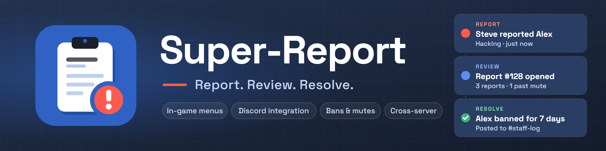
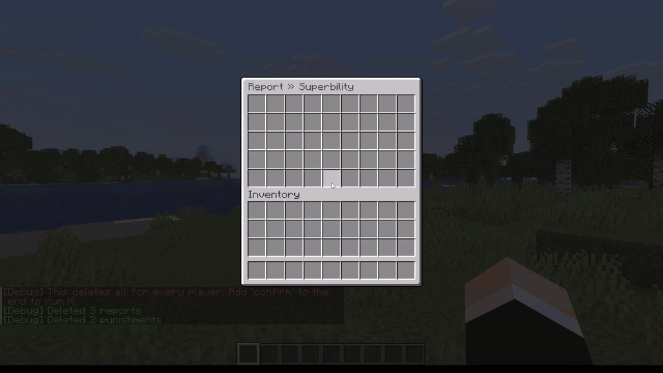
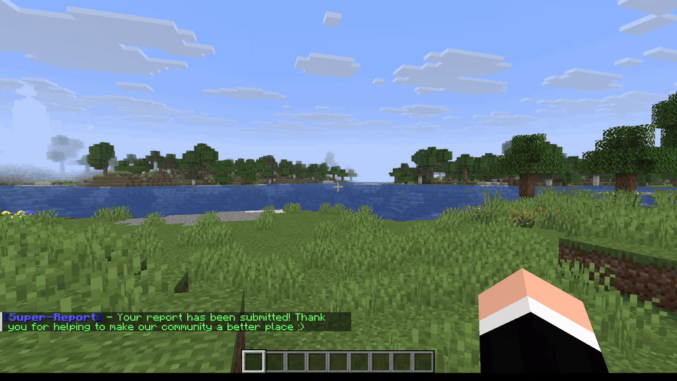
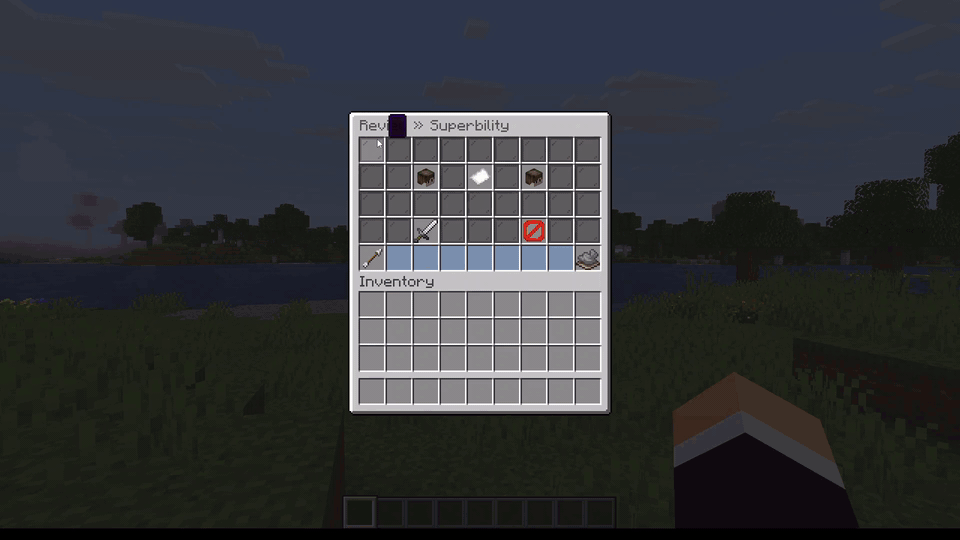
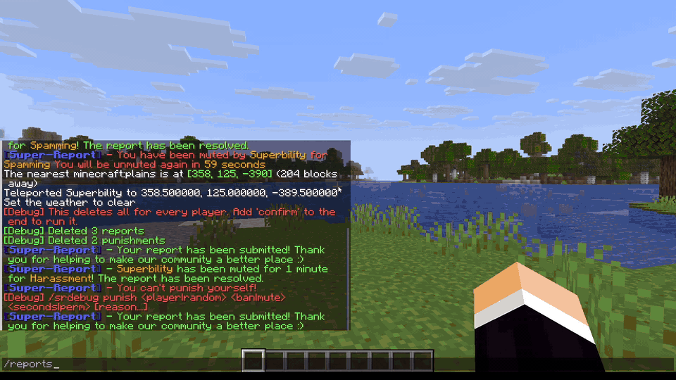

<p align="center">
  
</p>

<p align="center">
  Player reports, bans and mutes through clean in-game menus, with a live Discord log for your staff team.
</p>

<p align="center">
  
  
  
</p>

<p align="center">
  <a href="docs/README.md"><b>Documentation</b></a> ·
  <a href="https://github.com/aidan-b07/Super-Report/releases/latest"><b>Download</b></a> ·
  <a href="https://discord.gg/3wqbfmX74P"><b>Support Discord</b></a>
</p>

---

## Features

- **Reporting in a couple of clicks.** `/report <player>` opens a menu of reasons, or `/report <player> <reason>` sends it straight away. Staff online are told immediately, and again when they join if reports are waiting.
- **One place to review everything.** `/reports` lists open reports with each player's head, newest first. Open one to see both players' history, then punish or dismiss it.
- **Bans and mutes without typing durations.** Pick ban or mute, a reason and a length (with presets for common ones) from menus. `/punish`, `/ban` and `/mute` use the same menus without a report.
- **A Discord log that stays up to date.** Reports, bans and mutes are posted as embeds. When a report is dealt with, or a punishment is lifted or runs out, the original message updates to show it.
- **Full history.** Nothing is deleted: every report and punishment is kept with who handled it and when.
- **Networks supported.** Share one MySQL database between servers. Bans apply everywhere and players on other servers can be reported.
- **Everything is configurable.** Messages, menus, reasons and every part of the Discord embeds.

## See it in action

### Reporting a player

`/report <player>` opens the reason menu. Hover over a reason to see what it covers, and click to send the report.

<p align="center">
  
</p>

### Open reports

`/reports` lists every open report. Hover over one to see the reason, who sent it and when.

<p align="center">
  
</p>

### Handling a report

Open a report to see the player's history, then dismiss it or punish them. Here the player is muted: pick a reason, pick a length, and the report is resolved.

<p align="center">
  
</p>

### Banning

Bans work the same way. Pick a reason and a length, and the player is kicked straight away with the ban screen.

<p align="center">
  
</p>

## Installation

1. Download `SuperReport.jar` and put it in your server's `plugins` folder.
2. Start the server once. Super-Report creates its config files in `plugins/SuperReport/`.
3. Change anything you want in those files and restart.

It works out of the box with a local SQLite database. To share data between servers, see [MySQL](#mysql).

**Requirements:** Spigot or Paper, Minecraft 1.8.8 or newer, Java 8 or newer (whatever your server version needs).

## Commands

| Command | What it does | Permission |
|---|---|---|
| `/report <player> [reason]` | Report a player. Without a reason, opens the reason menu | `superreport.report` |
| `/reports` | Review open reports | `superreport.reports` |
| `/punish <player>` | Ban or mute a player through the menus | `superreport.punish` |
| `/ban <player>`, `/tempban <player>` | Ban through the menus, starting at the reason | `superreport.punish` |
| `/mute <player>`, `/tempmute <player>` | Mute through the menus, starting at the reason | `superreport.punish` |
| `/unban <player>` | Lift a ban | `superreport.unban` |
| `/unmute <player>` | Lift a mute | `superreport.unmute` |
| `/superreport`, `/sr` | List the Super-Report commands you can use | `superreport.help` |
| `/superreport reload`, `/sr reload` | Read every config file again and reconnect the Discord bot | `superreport.reload` |

## Permissions

| Permission | Default | What it does |
|---|---|---|
| `superreport.report` | Everyone | Use `/report` |
| `superreport.help` | Everyone | Use `/superreport` |
| `superreport.reload` | Op | Use `/superreport reload` |
| `superreport.reports` | Op | Use `/reports` |
| `superreport.punish` | Op | Use `/punish`, `/ban` and `/mute` |
| `superreport.unban` | Op | Use `/unban` |
| `superreport.unmute` | Op | Use `/unmute` |
| `superreport.notifications` | Op | Get told about new reports, and how many are open on join |
| `superreport.updates` | Op | Get told when a new version of Super-Report is out |
| `superreport.banbypass` | Nobody | Can't be banned |
| `superreport.mutebypass` | Nobody | Can't be muted |

## Configuration

All files are in `plugins/SuperReport/`.

| File | What's in it |
|---|---|
| `config.yml` | Database, server name and the Discord bot |
| `Messages.yml` | Every chat message, the ban screen and the mute notice |
| `ReportMenu.yml` | The `/report` reason menu |
| `Ban-Reasons.yml` | Reasons in the ban menu |
| `Mute-Reasons.yml` | Reasons in the mute menu |

Colour codes use `&`. If a setting the plugin needs is missing from one of these files, it's added back on the next start, and anything you've changed is left alone.

Every option is explained in the docs: [config.yml](docs/configuration/config.md), [Messages.yml](docs/configuration/messages.md) and [the menus](docs/configuration/menus.md).

### MySQL

To share reports and punishments between servers, point them all at the same MySQL database:

```yaml
MySQL:
  MySqlEnabled: true
  host: localhost
  port: 3306
  database: superreport
  username: root
  password: password

# Give each server its own name
ServerName: "Survival"
```

The tables are created automatically. Each server needs its own `ServerName`. It's shown in Discord embeds and used to track which server each player is on. See [Networks](docs/networks.md) for what's shared between servers.

## Discord bot

Super-Report can post every report, ban and mute to Discord, and update those messages as things change.

### 1. Create the bot

1. Open the [Discord Developer Portal](https://discord.com/developers/applications) and click **New Application**. Give it a name, e.g. `Reports`.
2. Go to **Bot** and click **Reset Token**. Copy the token and keep it private: anyone with it can control your bot.
3. You can leave all the **Privileged Gateway Intents** turned off. The bot only sends and edits its own messages.

### 2. Invite it to your server

1. Go to **OAuth2** → **URL Generator**.
2. Under **Scopes**, tick `bot`.
3. Under **Bot Permissions**, tick:
   - `View Channels`
   - `Send Messages`
   - `Embed Links`
   - `Mention Everyone`, only if you want it to ping a role that isn't mentionable
4. Open the generated link and add the bot to your server.

Make sure it can see and send messages in the channels you want to use.

### 3. Get the channel IDs

1. In Discord, open **User Settings** → **Advanced** and turn on **Developer Mode**.
2. Right-click each channel you want to use and click **Copy Channel ID**.

Reports, bans and mutes can each go to their own channel, or all to the same one.

### 4. Set it up in `config.yml`

```yaml
DiscordBot:
  Enabled: true
  Token: "your bot token"
  ReportMessage:
    ChannelID: "123456789012345678"
    Layout:
      # Optional: ping a role above each report
      Message: "<@&ROLE_ID>"
  BanMessage:
    ChannelID: "123456789012345678"
  MuteMessage:
    ChannelID: "123456789012345678"
```

Restart the server. The console warns if the token is wrong or a channel can't be found.

To ping a role, enable Developer Mode as above, right-click the role in **Server Settings** → **Roles**, and copy its ID.

### Customising the embeds

Every part of each embed can be changed in `config.yml`: colour, author, title, thumbnail, description, fields and footer. Each embed starts with a **Status** box (`OPEN`, `RESOLVED`, `BANNED`, `LIFTED`, `EXPIRED` and so on), which updates as things happen.

The [Discord bot docs](docs/discord.md) list every setting and placeholder.

## Building from source

You need JDK 8 or newer and Maven.

```bash
mvn package -Dserver.skip=true
```

The plugin is built to `target/SuperReport.jar`.

Without `-Dserver.skip=true`, the build also downloads a Paper test server into `run/<version>/` and installs the plugin there. Pick the version with `-Dserver.version=1.8.8`, or use `-Dserver.version=all` to install into every test server you already have. The `debug-plugin/` folder holds test-only tools for those servers and is never part of a release.

## Support

Found a bug or have an idea? [Open an issue](https://github.com/aidan-b07/Super-Report/issues) or ask in the [support Discord](https://discord.gg/3wqbfmX74P).

## License

Super-Report is free and its source is open. You can use it on any server, including ones that make money, and you can fork and change it.

You can't sell it or a fork of it, or re-upload the original. Forks need their own name and a link back here. See [LICENSE](LICENSE) for the full terms.
